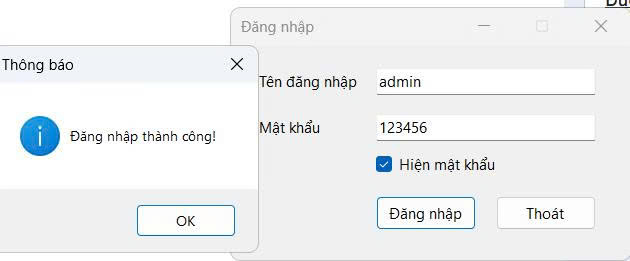
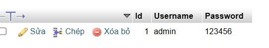
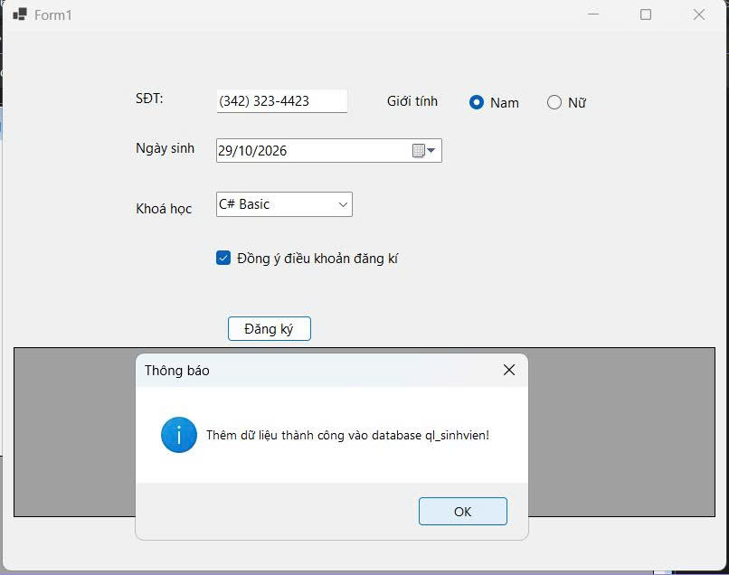
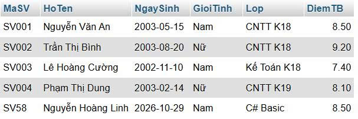

# BÁO CÁO BÀI TẬP / ĐỒ ÁN

## THÔNG TIN SINH VIÊN
- **Họ và tên:** Nguyễn Hoàng Linh
- **Mã số sinh viên:** 24810320338
- **Lớp:** D19QTANM1
- **Tên môn học:** Lập trình C# / Windows Forms
- **Tên bài tập:** Bt 5.1_5.2

---

## KẾT QUẢ THỰC HÀNH

### **B 5.1**
### 1. Ảnh màn hình Chức năng thực thi / Kết quả

### 2. Ảnh màn hình bên My SQL 

---
### **B 5.2**
### 1. Ảnh màn hình Chức năng thực thi / Kết quả

### 2. Ảnh màn hình bên My SQL 

---
